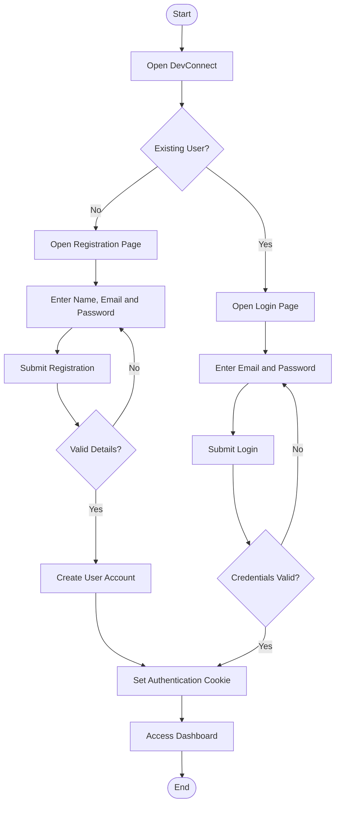
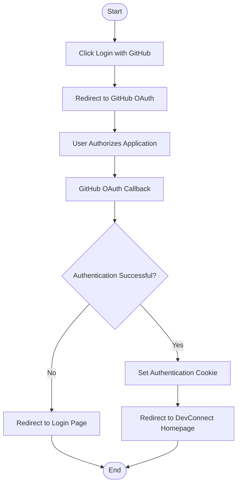
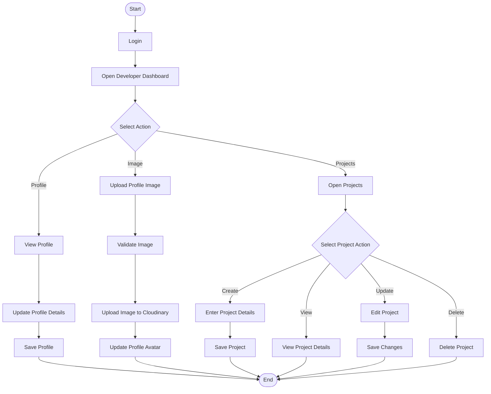
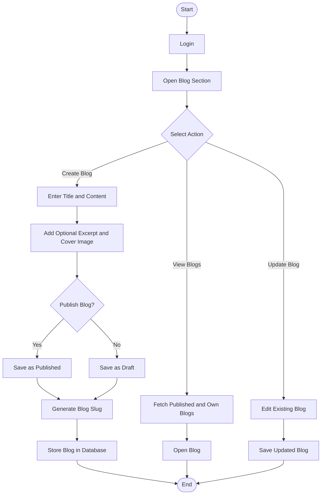
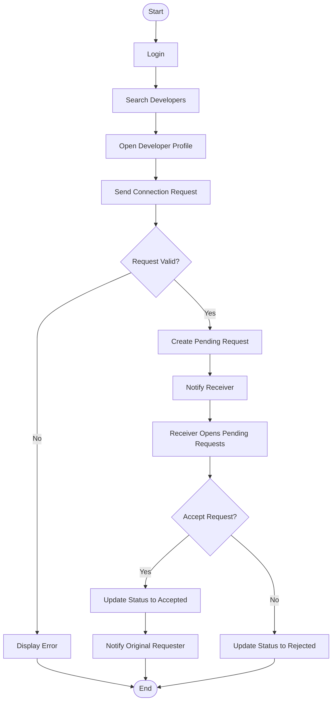
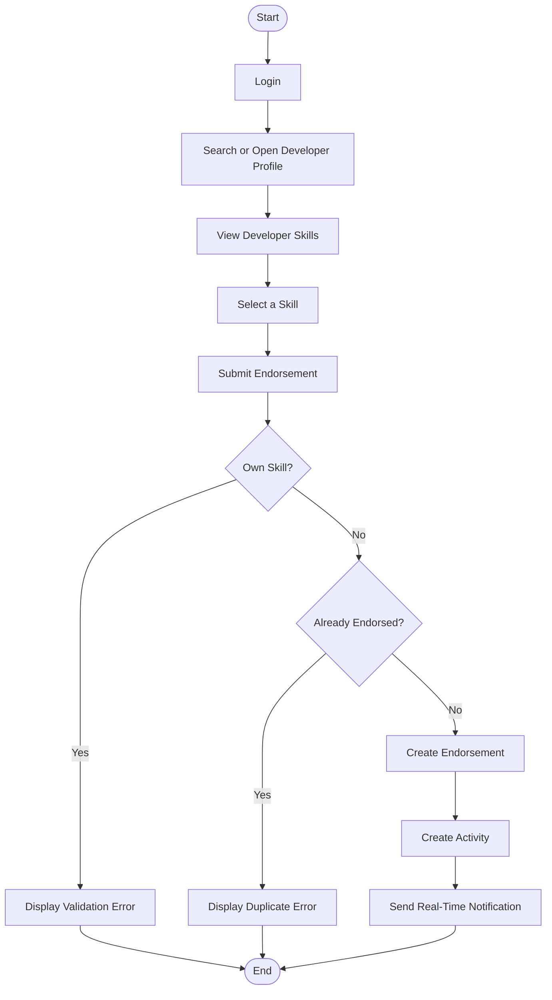
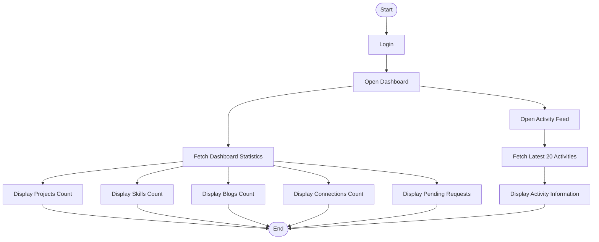

# DevConnect – User Flow Diagrams

## 1. User Registration and Login Flow

This flow describes how users register, log in, and access the DevConnect platform.

## 2. GitHub OAuth Login Flow

This flow describes authentication through GitHub.

## 3. Developer Profile and Project Management Flow

This flow describes how an authenticated developer manages their profile and projects.

## 4. Blog Management Flow

This flow describes creating, viewing, and updating blog posts.

## 5. Developer Connection Flow

This flow describes sending, accepting, and rejecting connection requests.

## 6. Skill Endorsement Flow

This flow describes how developers endorse another developer's skills.

## 7. Dashboard and Activity Flow

This flow describes how users view dashboard statistics and recent activities.

## Conclusion

The user flow diagrams represent the major workflows of DevConnect, including account authentication, GitHub OAuth, profile management, project management, blogging, developer connections, skill endorsements, and dashboard activities.